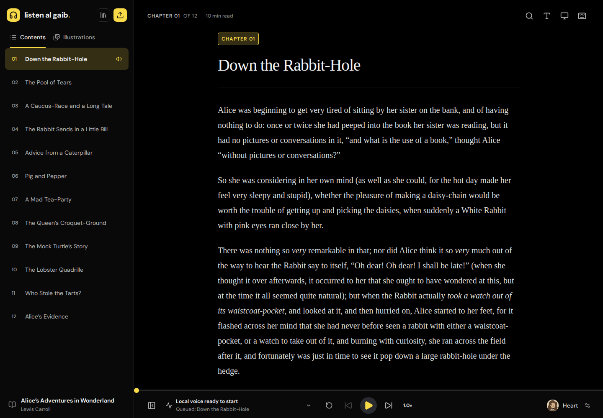
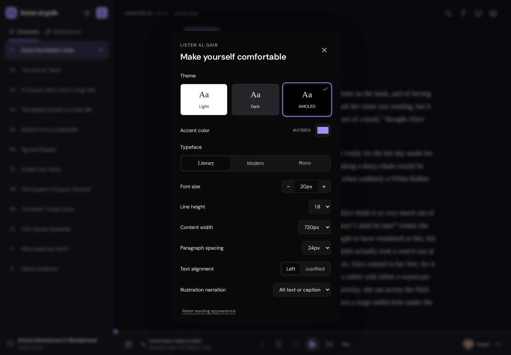
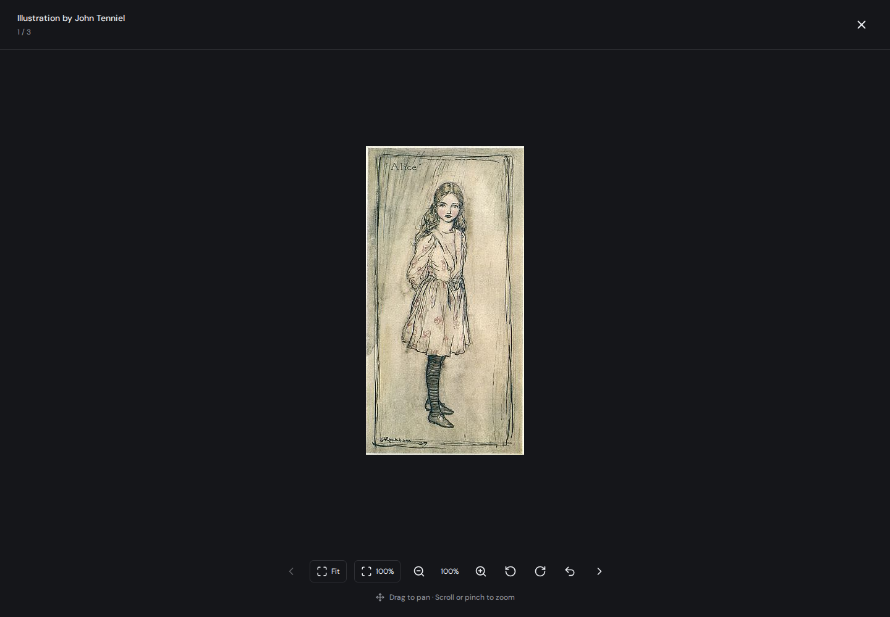

# Listen al Gaib
> yes, you are obligated to read Dune on this.

A simple EPUB reader with local text-to-speech. Runs in your browser. No login.

## Features

- Read DRM-free EPUBs or listen with six English Kokoro voices.
- Change playback speed, replay a passage, or skip forward and back.
- Import multiple books, search your library, and save reading progress.
- Navigate chapters and search inside a book.
- AMOLED by default, with light and dark modes, custom accent colors, and typography settings.
- Browse illustrations in a gallery or open them full screen with zoom and pan.
- Works on desktop and mobile.

## Appearance

## Illustrations

## Local storage and narration

Books and progress stay in your browser. Speech is generated on your device; book text is not sent to a speech service.

Voices need an initial download. Cached voice files and app resources can be reused offline. Books do not sync between devices. Clearing site data removes your saved library and progress.

To try the bundled sample, open **My library → Read the Alice sample**.

## Shortcuts

| Key | Action |
| --- | --- |
| Space | Play / pause |
| ← / → | Previous / next passage |
| C | Contents |
| I | Illustrations |
| Esc | Close panel or viewer |

## Credits

Narration: Kokoro. Alice sample: public-domain text and illustrations from Project Gutenberg. [Sample sources](public/demo/SOURCES.txt) · [Voice portrait sources](public/voices/SOURCES.json)
